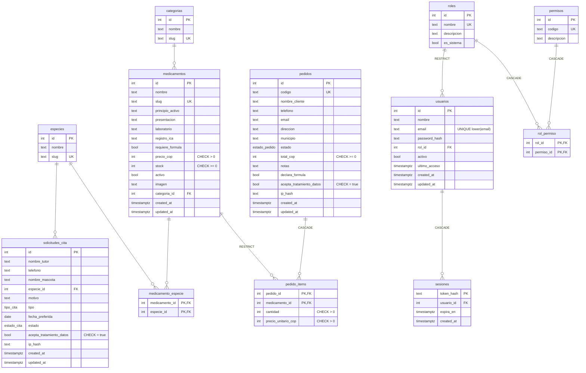

# Fase 1 · Análisis y plan de Vitalis Centro Veterinario

Entregables de la sección 6 del prompt. No hay código todavía: esto se aprueba antes de empezar la Fase 2.

## Decisiones aprobadas

| Tema | Decisión |
| :-- | :-- |
| Tienda | En `/tienda`, con accesos rápidos desde la portada |
| Hosting | Vercel (plan gratuito) |
| Base de datos | **Neon** (PostgreSQL, plan gratuito, región AWS US East 1). Se descartó Supabase porque su plan gratis solo permite 2 proyectos activos y ya estaban en uso |
| Tipografía | Cormorant Garamond + Manrope, en minúsculas normales (no todo en mayúsculas) |
| Panel | **Usuarios con roles y permisos**, gestionables desde `/admin` |
| Skills extra | `webapp-testing` y `supabase-postgres-best-practices` instaladas |
| Textos | Titular y tagline aprobados de momento |

Los datos que faltan (dirección, WhatsApp, horario, doctor, procedimientos, domicilios, pagos) se dejan como `<Pending>`. Solo se ven en `pnpm dev` y nunca llegan al build.

---

## 0. Verificación del entorno

| Requisito | Estado |
| :-- | :-- |
| Skill `landing-page-design` | Instalada en `.claude/skills/` |
| Skill `ui-ux-pro-max` | Instalada, su buscador funciona |
| Skill `scroll-world` | Instalada. Solo se usa su técnica de scrub; no se generan vídeos |
| Node.js | v22.23.5 (pide ≥ 22.12) |
| pnpm | 10.28.0 |
| ffmpeg / ffprobe | 6.1.1 |
| potrace | **No está.** Se instala en la Fase 2 con `apt-get install potrace`. En Windows: binario de potrace.sourceforge.net |

---

## 1. El material y dónde va

| Archivo | Qué se ve | Dónde va |
| :-- | :-- | :-- |
| `originales/logo-vitalis.jpg` | Logo completo: perro azul con huesos, gato dorado con columna, círculo de pincel dorado, "VITALIS", "CENTRO VETERINARIO" y la línea de servicios | Se vectoriza a SVG. Logo completo en el footer y en la 404. Isotipo + palabra "VITALIS" en la cabecera. Isotipo como favicon, apple-touch-icon e iconos del manifest |
| `originales/recepcion.jpg` | Recepción: letrero retroiluminado, mostrador blanco con LED cálido, flores, afiche | Sección **Ubicación y horarios** (la foto de "así nos encuentras"), `og-image.jpg` (con el logo) y `public/photos/` para el JSON-LD |
| `video/recorrido-1-recepcion.mp4` | Letrero, flores, afiche de bienvenida, diploma | Parada 1 del scroll world: **bienvenida y confianza** |
| `video/recorrido-2-estanteria-dorada.mp4` | Estanterías con figuras doradas y plantas | Parada 2: **cuidado y medicamentos** |
| `video/recorrido-3-modelos-oseos.mp4` | Modelos de huesos y columna, libros de ortopedia, diplomas | Parada 3: **ortopedia, neurocirugía y rehabilitación** |
| `posters/*.webp` | Primer fotograma de cada clip | Debajo de cada vídeo mientras carga. El póster 1 es la imagen LCP del hero (`fetchpriority="high"`) |

Peso del material (ya optimizado):

| Archivo | Antes | Después |
| :-- | --: | --: |
| Vídeo del recorrido (1 archivo → 3 clips) | 7,0 MB | 3,8 MB |
| Logo | 55 KB (JPG) | 45 KB (WebP). El SVG saldrá en la Fase 2 |
| Recepción | 169 KB (JPG) | 24 KB (AVIF 600 px) / 63 KB (AVIF 1200 px) |
| Pósters | n/a | 10 a 19 KB cada uno |

**Material que falta** (la landing funciona sin él, con huecos marcados como pendientes):
- Foto del doctor (sección "El doctor").
- Quirófano, equipos o sala de rehabilitación (sección Servicios).
- Pacientes en recuperación o rehabilitación, con permiso del tutor.
- Fachada o entrada desde la calle (ayuda a llegar).
- Fotos de los medicamentos. Mientras no haya, cada tarjeta muestra un icono de su categoría en vez de foto, sin imágenes de stock.

Los textos de los diplomas y del afiche no se usan como contenido.

---

## 2. Paleta y tipografía

### Tokens de color

| Token | Hex | Uso |
| :-- | :-- | :-- |
| `azul-900` | `#071834` | Azul marino del logo. Texto principal, botón principal, footer y CTA final |
| `azul-700` | `#1B3360` | Hover del botón principal y superficies oscuras secundarias |
| `dorado-400` | `#CCA76C` | Dorado del logo. Solo acento: círculo, líneas, iconos, el punto del logo, fondo de botón secundario |
| `dorado-700` | `#8A6A2E` | Dorado oscuro para texto pequeño dorado (etiquetas, "eyebrows") sobre fondos claros |
| `crema-50` | `#FBF7F0` | Fondo base. Blanco cálido, como las paredes con LED cálido |
| `arena-100` | `#F3EADB` | Fondo de secciones alternas y tarjetas |
| `blanco` | `#FFFFFF` | Tarjetas de producto y formularios |
| `tinta-600` | `#4B5567` | Texto secundario |
| `azul-led` | `#2B4FC7` | Acento secundario inspirado en el letrero iluminado. Solo enlaces y foco, con mesura |

### Contrastes (WCAG 2.2)

| Texto | Fondo | Contraste | Resultado |
| :-- | :-- | --: | :-- |
| `azul-900` | `crema-50` | 16,53 | AAA |
| `azul-900` | `blanco` | 17,66 | AAA |
| `azul-900` | `arena-100` | 14,80 | AAA |
| `tinta-600` | `crema-50` | 7,04 | AAA |
| `tinta-600` | `arena-100` | 6,30 | AA |
| `dorado-700` | `crema-50` | 4,70 | AA |
| `dorado-700` | `blanco` | 5,02 | AA |
| `azul-900` | `dorado-400` | 7,83 | AAA (botón secundario dorado) |
| `crema-50` | `azul-900` | 16,53 | AAA (footer, CTA final) |
| `dorado-400` | `azul-900` | 7,83 | AAA (acentos sobre azul) |
| `blanco` | `azul-700` | 12,43 | AAA (hover del botón) |
| `azul-led` | `crema-50` | 6,46 | AA (enlaces) |
| `dorado-400` | `crema-50` | 2,11 | **No apto para texto**. Solo decoración |
| `dorado-400` | `blanco` | 2,26 | **No apto para texto**. Solo decoración |

### Tipografía

- **Titulares: Cormorant Garamond** (500 y 600). Serif romana clásica, la más cercana a las mayúsculas de "VITALIS" que sigue leyéndose bien en minúsculas y en frases largas. Cinzel se parece más al logo, pero solo tiene mayúsculas y un titular largo en mayúsculas cansa en el celular. Solo se usa a partir de 30 px, porque su x-height es pequeña.
- **Texto: Manrope** (400, 500 y 600). Sans geométrica espaciada como "CENTRO VETERINARIO" y está en la lista aprobada de landing-page-design.
- Ambas desde el propio dominio, `woff2` recortado a latín, `font-display: swap` y precarga solo del peso del hero.
- Sin cursivas y sin pesos 900.

### Dónde me aparto de las skills (y por qué)

| Regla de la skill | Decisión | Motivo |
| :-- | :-- | :-- |
| Una sola tipografía (landing-page-design B1) | Dos: Cormorant Garamond + Manrope | Lo pide el prompt para parecerse al logo. La skill dice que el usuario manda |
| Degradado del titular del hero `#000 → #666` | `azul-900 → tinta-600` | El mismo efecto con los colores de marca |
| Fondos oscuros solo de su lista | `azul-900` en footer y CTA final | Es el color de marca |
| Iconos Phosphor, Solar o Iconamoon | Phosphor | Coincide con el prompt |
| Sin degradados de fondo | El velo del vídeo en móvil es plano (`azul-900` al 55 %), no un degradado | Cumple la regla y deja el texto legible |

ui-ux-pro-max propuso un sistema genérico de clínica (verde azulado y naranja, claymorphism). Lo descarto porque no tiene nada que ver con la marca. De ella sí tomo las reglas de accesibilidad, rendimiento y formularios y el checklist de entrega.

---

## 3. Output format de landing-page-design

### 3.1 Outline de la página

Portada `/` (prerenderizada):

1. **Cabecera píldora flotante**: isotipo + VITALIS, enlaces (Servicios, Medicamentos, Ubicación, Preguntas) y botón "Pedir medicamentos". Menú a pantalla completa en el celular.
2. **Hero / scroll world** con 3 paradas. El titular, el CTA principal y la línea de prueba están en la primera parada.
3. **Servicios**: Ortopedia, Neurocirugía, Rehabilitación y el proceso (valoración → cirugía → rehabilitación). CTA secundario: "Agendar valoración".
4. **Tagline** (sección obligatoria B11, palabra por palabra).
5. **El doctor**: solo datos verificados. Hoy, todo pendiente salvo "especializado en ortopedia".
6. **Medicamentos**: categorías y especies como accesos directos a `/tienda`, más el botón "Ver medicamentos".
7. **Cómo pedir** en 3 pasos.
8. **Por qué Vitalis**: beneficios.
9. **Testimonios**: pendiente (oculta en el build mientras no haya).
10. **Ubicación y horarios**: foto de la recepción, dirección, horario y mapa que carga al hacer clic.
11. **Agendar valoración**: formulario de cita.
12. **Preguntas frecuentes**.
13. **CTA final**: el mismo "Pedir medicamentos" del hero.
14. **Footer**: logo, contacto, redes, política de datos y términos.
15. **Botón flotante de WhatsApp**.

Otras rutas:

| Ruta | Render | Por qué |
| :-- | :-- | :-- |
| `/tienda` | Servidor | Precio y stock vienen de la base de datos. Filtros por URL (`?especie=gato&categoria=antiparasitarios&q=...`), así funcionan sin JavaScript y se pueden compartir |
| `/tienda/[slug]` | Servidor | Ficha del medicamento, indexable para "medicamentos veterinarios Girardot" |
| `/pedido` | Servidor | Carrito y datos de entrega, crea el pedido con una Astro Action |
| `/admin/*` | Servidor | Panel protegido, `noindex` |
| `/politica-de-datos`, `/terminos` | Prerender | Ley 1581. Datos del responsable pendientes |
| `/404` | Prerender | Página de error con la marca |

**Cambio respecto al prompt:** la tienda completa sale de la portada y va a `/tienda`. Una portada prerenderizada no puede mostrar stock ni precios al día sin pedirlos por JavaScript, que pesa más y no indexa. En la portada queda un bloque de acceso rápido por categorías y especies.

### 3.2 Hero

Va en la primera parada del scroll world, con el vídeo de la recepción detrás:

- **Titular:** Cuidamos cómo se mueve tu mascota
- **Subtítulo:** Centro veterinario en Girardot especializado en ortopedia, neurocirugía y rehabilitación. Pide sus medicamentos veterinarios y te confirmamos por WhatsApp.
- **CTA principal:** Pedir medicamentos
- **Línea de prueba:** Te atiende un médico veterinario especializado en ortopedia.

Las otras dos paradas:

| Parada | Clip | Título | Texto |
| :-- | :-- | :-- | :-- |
| 2 | Estantería dorada | Cuidado en cada detalle | Medicamentos veterinarios con precio y disponibilidad a la vista, y orientación antes de confirmar tu pedido. |
| 3 | Modelos óseos | Volver a caminar, a correr, a jugar | Ortopedia, neurocirugía y rehabilitación en un mismo lugar, con un médico veterinario especializado en ortopedia. |

**Tagline (B11):** "Cada paso de tu mascota importa. / Por eso la cuidamos desde el hueso."

### 3.3 Beneficios

1. **Un especialista en ortopedia** — quien opera es un médico veterinario especializado en procedimientos de ortopedia.
2. **Del diagnóstico a la rehabilitación** — ortopedia, neurocirugía y rehabilitación en un mismo centro, sin ir de un lugar a otro.
3. **Pides en minutos** — buscas por especie o categoría, ves precio y disponibilidad y confirmas por WhatsApp.
4. **Sabes qué le das** — cada medicamento muestra principio activo, presentación, laboratorio y registro ICA, y te avisamos si necesita fórmula médica veterinaria.

No hay cifras porque no las tenemos. Cuando haya datos verificados (años, cirugías, reseñas de Google) se añaden.

### 3.4 Cómo funciona

Pedir medicamentos:
1. **Busca** el medicamento por nombre, especie o categoría.
2. **Agrégalo y deja tus datos** de entrega.
3. **Confirmamos por WhatsApp** disponibilidad, pago y entrega. *(Medios de pago y domicilios: pendientes.)*

Ortopedia (en la sección Servicios):
1. **Valoración**: el doctor revisa a tu mascota y te explica el diagnóstico y las opciones.
2. **Cirugía**: si hace falta, se programa el procedimiento.
3. **Rehabilitación**: acompañamiento para que recupere su movilidad.

### 3.5 Preguntas frecuentes

Las marcadas *(por validar)* se redactan así, pero el doctor tiene que confirmarlas antes de publicar.

1. **¿Necesito fórmula médica para comprar un medicamento?** Algunos sí. El catálogo marca cuáles. Para esos te pediremos la fórmula médica veterinaria por WhatsApp antes de confirmar el pedido.
2. **¿Los medicamentos son originales?** Cada ficha muestra el laboratorio y el registro ICA del producto. *(Pendiente: confirmar proveedores.)*
3. **¿Cómo pago mi pedido?** *(Pendiente: medios de pago.)* Por ahora el pago se acuerda por WhatsApp al confirmar.
4. **¿Hacen domicilios?** *(Pendiente: zonas y costo.)*
5. **¿Qué animales atienden?** Perros y gatos. *(Pendiente: si atienden otras especies.)*
6. **¿Qué es la neurocirugía veterinaria?** La cirugía que trata problemas de la columna y del sistema nervioso, por ejemplo cuando una mascota pierde fuerza o movilidad en las patas. *(por validar)*
7. **¿Cómo preparo a mi mascota para una cirugía?** El doctor te da las indicaciones en la valoración, como el ayuno y los exámenes previos que necesite. *(por validar)*
8. **¿Cuánto dura la recuperación de una cirugía ortopédica?** Depende del procedimiento y de cada paciente. En la valoración te explicamos el tiempo estimado y el plan de rehabilitación. *(por validar)*
9. **¿Atienden urgencias?** *(Pendiente.)*
10. **¿Dónde están y en qué horario atienden?** En Girardot, Cundinamarca. *(Pendiente: dirección y horario.)*

Las preguntas con respuesta pendiente no salen en el build ni en el JSON-LD hasta que tengan respuesta.

### 3.6 SEO / AEO

**Indexar: sí.** Es una oferta permanente y la búsqueda local coincide con lo que promete la página.

| Página | Título | Descripción |
| :-- | :-- | :-- |
| `/` | Veterinaria en Girardot: ortopedia y medicamentos · Vitalis | Centro veterinario en Girardot especializado en ortopedia, neurocirugía y rehabilitación. Pide medicamentos veterinarios y confírmalos por WhatsApp. |
| `/tienda` | Medicamentos veterinarios en Girardot · Vitalis | Antiparasitarios, antibióticos, antiinflamatorios y más para perros y gatos. Consulta precio y disponibilidad y pide por WhatsApp. |
| `/tienda/[slug]` | {Medicamento} · Medicamentos veterinarios Vitalis | Principio activo, presentación, especie y disponibilidad. |
| `/admin/*` | noindex | |

JSON-LD: `VeterinaryCare` (con dirección, geo, horario, teléfono, `sameAs` y área servida cuando existan), `WebSite`, `WebPage` y `FAQPage` solo con las preguntas respondidas. Sitemap sin `/admin`, `/pedido` ni la 404. `robots.txt`, `llms.txt`, canonical, `lang="es-CO"`, Open Graph y Twitter Card.

### 3.7 Layout recomendado

**B. Long form story**, abierto con el scroll world. Quien llega necesita confiar antes de dejar a su mascota en una cirugía o de comprar un medicamento por internet. El recorrido por la clínica real, los servicios explicados, el proceso y las preguntas frecuentes construyen esa confianza en orden. Toma de A una sola cosa: el CTA principal visible desde la primera pantalla.

Detalle del scroll world:
- **Escritorio:** vídeo vertical fijo a la derecha a toda la altura, con la parte de arriba en arco, y el texto de cada parada a la izquierda.
- **Celular:** el vídeo ocupa toda la pantalla de fondo, el texto va encima con un velo plano.
- Carga por cercanía, pósters debajo, sin vídeo con `prefers-reduced-motion` o ahorro de datos, y `play()` + `pause()` para iOS.

---

## 4. Base de datos

PostgreSQL con Drizzle ORM. Cambios respecto al modelo del prompt:

| Cambio | Por qué |
| :-- | :-- |
| `pedidos.declara_formula` | Guarda que el cliente dijo tener fórmula para los medicamentos que la piden. El servidor rechaza el pedido si hay uno de esos y está en `false` |
| `ip_hash` en `pedidos` y `solicitudes_cita` | El rate limit sale de una consulta ("¿cuántos envíos desde este hash en 10 minutos?"), sin tabla extra ni Redis. Se guarda un hash con sal, nunca la IP |
| `updated_at` en `pedidos` y `solicitudes_cita` | Para saber cuándo cambió el estado desde el panel |
| `usuarios`, `roles`, `permisos`, `rol_permiso` y `sesiones` | Roles y permisos para `/admin` sin librería de autenticación. Contraseña con `scrypt` de `node:crypto`, sesión en cookie `HttpOnly` + `Secure` + `SameSite=Lax`, y en la base solo el hash del token, así se puede revocar. El primer usuario se crea con un script por consola, no hay registro público |
| Todo en el schema `vitalis`, no en `public` | Separa las tablas de la app de lo que cree el proveedor y facilita dar permisos solo sobre ese schema |
| Rol de base de datos `vitalis_app` con permisos mínimos | La app no se conecta como `postgres`. Solo tiene `SELECT/INSERT/UPDATE` donde hace falta y `DELETE` únicamente en `sesiones`, `medicamento_especie` y `rol_permiso` |
| `ON DELETE RESTRICT` de `pedido_items` a `medicamentos` | Un medicamento con pedidos no se borra: se desactiva (`activo = false`). Así el historial no se rompe |
| IDs `integer generated always as identity` | Más pequeños y rápidos que UUID. El código público del pedido es aparte (`VIT-7K3Q9`), así no se exponen IDs secuenciales |
| `timestamptz` en todas las fechas | Sin errores de zona horaria (Colombia es UTC−5) |



Enums: `estado_pedido` (pendiente, confirmado, enviado, entregado, cancelado), `estado_cita` (pendiente, confirmada, atendida, cancelada) y `tipo_cita` (valoracion_ortopedica, control, otro).

### Roles y permisos

- **Permisos**: lista fija, porque el código los comprueba. Se crean en una migración:
  `medicamentos:ver`, `medicamentos:editar`, `pedidos:ver`, `pedidos:gestionar`, `citas:ver`, `citas:gestionar`, `usuarios:gestionar`, `roles:gestionar`.
- **Roles**: se crean, editan y borran desde `/admin/roles`, marcando qué permisos tiene cada uno. Roles iniciales:

| Rol | Permisos |
| :-- | :-- |
| Administrador | Todos. Es de sistema: no se puede borrar ni quitarle `usuarios:gestionar` ni `roles:gestionar`, para que nadie se quede fuera |
| Farmacia | `medicamentos:*` y `pedidos:*` |
| Recepción | `citas:*` y `pedidos:ver` |

- **Usuarios**: un rol por usuario. Se gestionan desde `/admin/usuarios` (crear, cambiar rol, desactivar, cambiar contraseña). Un usuario no puede desactivarse a sí mismo ni quitarse el rol de administrador si es el último.
- **Cómo se comprueba**: el middleware carga la sesión con los permisos del rol en una sola consulta. Cada página y cada Action de `/admin` llama a `requierePermiso('pedidos:gestionar')`. Sin permiso: 403 con la marca y un enlace de vuelta. El menú del panel solo muestra lo que el usuario puede usar.
- Sesiones de 12 horas. Al cambiar la contraseña o desactivar un usuario se borran sus sesiones. Login con límite de intentos.

Índices (además de PK y UNIQUE):
- `medicamentos (categoria_id)` y un índice parcial `medicamentos (nombre) WHERE activo`, porque la tienda solo lista activos.
- `medicamento_especie (especie_id)`. La PK ya cubre las búsquedas por medicamento.
- `pedido_items (medicamento_id)`.
- `pedidos (estado, created_at DESC)` y `solicitudes_cita (estado, created_at DESC)`, para el listado del panel.
- `pedidos (ip_hash, created_at)` y `solicitudes_cita (ip_hash, created_at)`, para el rate limit.
- `solicitudes_cita (especie_id)`.
- `usuarios (rol_id)`, `rol_permiso (permiso_id)`, `sesiones (usuario_id)` y `sesiones (expira_en)` para limpiar las caducadas.

La búsqueda por nombre usa `ILIKE` sobre un catálogo pequeño. Si pasa de unos miles de productos, se añade `pg_trgm`, no antes.

Reglas del servidor:
- El total se calcula con los precios de la base de datos. El navegador solo manda `[{slug, cantidad}]`.
- Pedido + ítems + descuento de stock van en una sola transacción, con `SELECT … FOR UPDATE` sobre los medicamentos para que dos pedidos no vendan la misma última unidad.
- Zod valida todo en el servidor: teléfono colombiano, cantidades, longitud de textos y el checkbox de la Ley 1581.
- El seed crea categorías y especies reales y medicamentos de ejemplo con nombres claramente ficticios (`[DEMO] ...`). Se niega a correr si `NODE_ENV=production`.

---

## 5. Hosting recomendado

**Vercel + Neon (PostgreSQL), los dos gratis.** Las rutas de servidor de Astro corren en Node con `@astrojs/vercel`, donde Drizzle con el driver `postgres` y `node:crypto` funcionan sin trucos.

- Neon gratis: 1 GB y 100 horas de cómputo al mes por proyecto, sin tarjeta y sin pausa por inactividad. Se apaga a los 5 minutos sin uso y se enciende solo con la siguiente consulta (la primera tarda un poco más).
- Región **AWS US East 1 (N. Virginia)**, junto a la región por defecto de las funciones de Vercel (`iad1`).
- Conexión de la app por el **pooler de Neon** (host con `-pooler`, PgBouncer en modo transacción) con `prepare: false`. Las migraciones van por la conexión directa.
- El driver `postgres` es estándar: cambiar de proveedor es cambiar la cadena de conexión.

No se despliega nada hasta que lo apruebes.

---

## 6. Estructura de carpetas

```text
.
├── .claude/skills/              Skills (ya instaladas)
├── recursos/                    Material original y optimizado (fuente, no se sirve)
├── docs/fase-1.md               Este documento
├── drizzle/                     Migraciones SQL generadas por drizzle-kit
├── public/
│   ├── video/                   recorrido-1…3.mp4
│   ├── photos/                  recepcion.jpg (1600 px, para JSON-LD y sitemap)
│   ├── og-image.jpg · favicon.svg · favicon.ico · apple-touch-icon.png
│   ├── icon-192.png · icon-512.png · site.webmanifest
│   └── robots.txt lo genera src/pages/robots.txt.ts
├── scripts/
│   └── crear-admin.ts           Crea el primer usuario administrador por consola
├── src/
│   ├── actions/
│   │   ├── index.ts             Exporta las acciones
│   │   ├── pedidos.ts           crearPedido
│   │   └── citas.ts             solicitarCita
│   ├── assets/
│   │   ├── brand/               logo.svg, isotipo.svg
│   │   ├── fotos/               recepcion.jpg
│   │   ├── posters/             recorrido-1…3.webp
│   │   └── fonts/               Cormorant Garamond y Manrope (woff2 latín) + licencias OFL
│   ├── components/
│   │   ├── layout/              Header, Footer, WhatsAppFlotante, SkipLink
│   │   ├── portada/             ScrollWorld, Parada, Servicios, Tagline, Doctor,
│   │   │                        AccesoTienda, ComoPedir, PorQue, Ubicacion, Faq, CtaFinal
│   │   ├── tienda/              Filtros, TarjetaMedicamento, Carrito
│   │   ├── formularios/         FormCita, FormPedido, Campo
│   │   ├── admin/               TablaMedicamentos, FormMedicamento, ListaPedidos, ListaCitas, FormUsuario, FormRol
│   │   └── ui/                  Boton, Icono, Pending
│   ├── data/
│   │   ├── vitalis.ts           Todo el contenido: paradas, textos, FAQ, contacto, horario, SEO
│   │   └── schema.ts            JSON-LD
│   ├── db/
│   │   ├── schema.ts            Tablas, enums, relaciones, índices y CHECKs (Drizzle)
│   │   ├── client.ts            Conexión
│   │   ├── queries/             medicamentos.ts, pedidos.ts, citas.ts, usuarios.ts, roles.ts
│   │   └── seed.ts              Datos de ejemplo (bloqueado en producción)
│   ├── lib/
│   │   ├── auth.ts              scrypt, sesiones, cookie y requierePermiso
│   │   ├── validacion.ts        Esquemas Zod compartidos
│   │   ├── formato.ts           COP y teléfono
│   │   ├── whatsapp.ts          Construye el enlace con el resumen
│   │   └── rate-limit.ts        Consulta por ip_hash
│   ├── layouts/
│   │   ├── Layout.astro         <head>, metas, OG, fuentes
│   │   └── AdminLayout.astro
│   ├── middleware.ts            Protege /admin
│   ├── pages/
│   │   ├── index.astro
│   │   ├── tienda/index.astro · tienda/[slug].astro
│   │   ├── pedido.astro
│   │   ├── admin/               index, login, medicamentos, pedidos, citas, usuarios, roles
│   │   ├── politica-de-datos.astro · terminos.astro · 404.astro
│   │   └── robots.txt.ts · llms.txt.ts
│   ├── scripts/
│   │   ├── motion.ts            Lenis + GSAP (apariciones, tagline)
│   │   ├── world.ts             Scrub del recorrido y cola de carga
│   │   └── cart.ts              Carrito en localStorage
│   └── styles/global.css        Tokens de Tailwind y estilos de texto con nombre
├── tests/
│   ├── unit/                    Vitest: totales, Zod, formato COP, WhatsApp
│   └── e2e/                     Playwright: pedido, cita, teclado, móvil y escritorio
├── .env.example · .editorconfig · .gitignore
├── astro.config.mjs · drizzle.config.ts · tsconfig.json
├── eslint.config.js · .prettierrc · vitest.config.ts · playwright.config.ts
└── README.md
```

Dependencias previstas, solo estas: `astro`, `@astrojs/vercel`, `@astrojs/sitemap`, `tailwindcss`, `@tailwindcss/vite`, `gsap`, `lenis`, `sharp`, `drizzle-orm`, `postgres`, `zod` (viene con Astro), `@phosphor-icons/core`. En desarrollo: `drizzle-kit`, `typescript`, `eslint`, `prettier`, `vitest`, `@playwright/test`, `tsx`.

No hay cookies de analítica ni de terceros (el mapa solo carga al hacer clic), así que no hace falta banner de cookies. Sí hay política de tratamiento de datos.

---

## 7. Preguntas (solo decisiones; los datos que faltan quedan pendientes)

1. **Tienda en `/tienda`** en vez de dentro de la portada, con accesos rápidos desde la portada. ¿De acuerdo?
2. **Hosting: Vercel + Neon.** ¿Lo apruebas, o prefieres Cloudflare o Supabase? → Vercel + Neon.
3. **Tipografía: Cormorant Garamond + Manrope.** ¿Te gusta, o prefieres Cinzel en los titulares para parecerse más al logo (todo en mayúsculas)?
4. **Admin:** un solo tipo de usuario administrador, sin roles. ¿Suficiente?
5. **Skills extra:** el prompt usa `webapp-testing` y `supabase-postgres-best-practices` "si están instaladas". ¿Las instalo antes de la Fase 2?
6. **Copy del hero y del tagline:** "Cuidamos cómo se mueve tu mascota" y "Cada paso de tu mascota importa. Por eso la cuidamos desde el hueso." ¿Van, o quieres otro tono?
