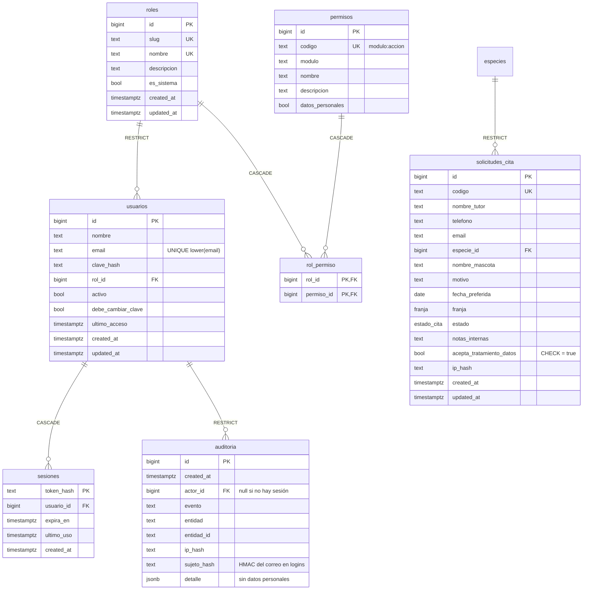

# Fase 4 · Plan (Paso 0)

Autenticación, roles y permisos, panel `/admin`, citas y pendientes de la Fase 3. No hay código hasta que se apruebe.

Entregas: **4A** autenticación + RBAC + auditoría · **4B** medicamentos, categorías y pedidos (con el cambio a venta solo en tienda) · **4C** citas · **4D** portal de clientes.

## Decisiones del usuario (respuestas a la sección 11)

| Tema | Decisión |
| :-- | :-- |
| Rol `usuario` | Se crea **con permisos reales de cliente** y un portal mínimo (entrega 4D). Ver la sección 12 |
| Exportar CSV | **Pospuesto.** Queda en `docs/pendientes.md` y se recuerda al cerrar cada entrega |
| Envíos | **No hay domicilios: solo venta y recogida en la clínica.** Se quita `enviado` y se dejan de pedir dirección y municipio. Ver la sección 13 |
| Aviso por WhatsApp al confirmar | **No se hace ahora.** Queda en pendientes |

---

## 1. Autenticación: sesiones propias

**Decisión: sesiones propias (~200 líneas) siguiendo el patrón de OWASP y de la guía de sesiones de Lucia**, sin librería.

| Opción | Por qué no / por qué sí |
| :-- | :-- |
| Lucia | Su autor la dejó de mantener en 2025 y recomienda escribir las sesiones a mano con su guía |
| Better Auth | Mantenida y completa, pero trae sus propias tablas y su plugin de roles. Choca con el schema `vitalis`, con los dos roles de base de datos y con el catálogo de permisos en código. Sería código de más para un solo panel |
| **Propias** | Poco código, todo bajo nuestro esquema y nuestros GRANT, sin dependencias |

Detalle:

- **Contraseñas: scrypt** de `node:crypto` con los parámetros de OWASP (N = 2^17, r = 8, p = 1, sal de 16 bytes, clave de 64 bytes, `maxmem` de 256 MB). Sin dependencias nativas. Se guarda como `scrypt$17$8$1$<sal>$<hash>`: si se suben los parámetros, el hash se rehace al iniciar sesión.
- **Comparación en tiempo constante** con `timingSafeEqual`. Si el correo no existe, se calcula igual un scrypt contra un hash falso: la respuesta tarda lo mismo y no revela si la cuenta existe.
- **Contraseña:** mínimo 12 caracteres, máximo 128, distinta del correo.
- **Sesiones en base de datos:** token aleatorio de 32 bytes. En la base solo se guarda su SHA-256; si alguien lee la tabla, no puede usar las sesiones.
- **Cookie** `__Host-vitalis_sesion`: `HttpOnly`, `Secure`, `SameSite=Lax`, `Path=/` y sin `Domain` (el prefijo `__Host-` lo obliga).
- **Expiración:** absoluta de 12 h e inactividad de 2 h. La fecha de último uso se actualiza como mucho cada 15 min, para no escribir en cada petición.
- **Invalidación:**
  - Cerrar sesión borra la sesión.
  - Cambiar contraseña, desactivar el usuario o cambiarle el rol borra todas sus sesiones.
  - Los **permisos se leen de la base en cada petición** (una consulta con JOIN). Por eso un cambio en los permisos de un rol surte efecto en la siguiente petición sin cerrar sesión.
- **Primer ingreso:** la columna `debe_cambiar_clave` obliga a pasar por `/admin/cambiar-clave` antes de usar el panel.

## 2. Dos roles de base de datos

| Rol | Conexión | Lo usa |
| :-- | :-- | :-- |
| `vitalis_app` | `DATABASE_URL` | Páginas públicas: tienda, pedido y citas |
| `vitalis_admin` | `DATABASE_URL_ADMIN` | Solo `/admin`, el login y sus Actions |

- **Separación en el código:** dos clientes, `src/db/client.ts` y `src/db/client-admin.ts`. Una regla de ESLint (`no-restricted-imports`) impide importar el cliente de admin fuera de `src/admin/`, `src/pages/admin/` y `src/actions/admin/`.
- **Qué protege:** un error de lógica o una inyección SQL en una página pública no puede leer usuarios, sesiones ni auditoría, ni cambiar pedidos.
- **Qué no protege:** si alguien ejecutara código arbitrario en el servidor, tendría las dos variables de entorno, porque comparten despliegue. Para eso hacen falta despliegues separados, que hoy sería exagerado.

### Permisos mínimos

**`vitalis_app` (se endurece respecto a la Fase 3):**

| Tabla | Permisos |
| :-- | :-- |
| especies, categorias, medicamentos, medicamento_especie | `SELECT` |
| medicamentos | `UPDATE (stock, updated_at)` |
| pedidos | `INSERT` y `SELECT` **solo de `id, codigo, ip_hash, created_at`**. Hoy puede leer la tabla entera; se le quita el acceso a los datos personales |
| pedido_items | `INSERT` |
| solicitudes_cita | `INSERT` y `SELECT (id, ip_hash, created_at)` para el límite de envíos |
| usuarios, sesiones, roles, permisos, rol_permiso, auditoria | **Nada** |

**`vitalis_admin`:**

| Tabla | Permisos |
| :-- | :-- |
| especies, permisos | `SELECT` |
| categorias | `SELECT, INSERT, UPDATE, DELETE` (el DELETE falla si tiene medicamentos, por `RESTRICT`) |
| medicamentos | `SELECT, INSERT, UPDATE, DELETE` (el DELETE solo prospera si nunca estuvo en un pedido, por `RESTRICT`) |
| medicamento_especie | `SELECT, INSERT, DELETE` |
| pedidos | `SELECT`, `UPDATE (estado, updated_at)` |
| pedido_items | `SELECT` |
| solicitudes_cita | `SELECT`, `UPDATE (estado, notas_internas, updated_at)` |
| usuarios | `SELECT, INSERT, UPDATE` (sin DELETE: se desactivan) |
| sesiones | `SELECT, INSERT, UPDATE, DELETE` |
| roles | `SELECT, INSERT, UPDATE, DELETE` |
| rol_permiso | `SELECT, INSERT, DELETE` |
| auditoria | **`SELECT, INSERT`**. Sin UPDATE ni DELETE: es de solo escritura y lectura |

Más el `USAGE` de las secuencias necesarias. Los dos roles tienen `statement_timeout` de 5 s.

**Protección extra en la base** (si falla el código, la base lo frena):
- **Trigger en `usuarios`:** impide desactivar o cambiar de rol al **último superadmin activo**. Toma un candado (`pg_advisory_xact_lock`) para que dos cambios simultáneos no lo dejen en cero.
- **Trigger en `roles`:** impide borrar o renombrar los roles de sistema y cambiar `es_sistema`.

## 3. Roles y catálogo de permisos

### Roles

| Rol | Tipo | Notas |
| :-- | :-- | :-- |
| superadmin | Sistema, intocable | Bypass explícito en **un solo lugar**: `can()` devuelve `true` si el rol es superadmin. Es el único que gestiona roles |
| admin | Sistema, permisos editables | Operación del día a día |
| usuario | Sistema, permisos editables | Cuenta de cliente del portal (4D). Solo ve y toca lo suyo |
| invitado | Implícito | No existe en la base: es quien no tiene sesión (tienda, pedido, citas) |
| Personalizados | Creados por el superadmin | Crear, editar, duplicar y eliminar (solo si no tienen usuarios) |

### Catálogo (vive en `src/admin/permisos.ts`)

Cada permiso corresponde a una comprobación real en el código. Los que exponen datos personales llevan la marca **🔒 datos personales**, y el editor de roles lo muestra.

| Módulo | Permiso | Qué permite | Depende de |
| :-- | :-- | :-- | :-- |
| Medicamentos | `medicamentos:ver` | Ver el catálogo en el panel, con inactivos | |
| | `medicamentos:crear` | Crear medicamentos | ver |
| | `medicamentos:editar` | Editar datos, precio, especies y activar o desactivar | ver |
| | `medicamentos:ajustar_stock` | Cambiar el stock con un motivo (queda en auditoría) | ver |
| | `medicamentos:eliminar` | Borrar **solo** si nunca estuvo en un pedido (creado por error). Si tiene pedidos, solo se desactiva | ver |
| Categorías | `categorias:gestionar` | Crear, renombrar y borrar categorías sin medicamentos | |
| Pedidos | `pedidos:ver` 🔒 | Ver pedidos con los datos del cliente | |
| | `pedidos:cambiar_estado` | Avanzar el estado | ver |
| | `pedidos:cancelar` | Cancelar y devolver el stock | ver |
| Citas | `citas:ver` 🔒 | Ver solicitudes con los datos del tutor | |
| | `citas:gestionar` | Cambiar estado y escribir notas internas | ver |
| Usuarios | `usuarios:ver` 🔒 | Ver usuarios del panel (nombre, correo, rol) | |
| | `usuarios:gestionar` | Crear usuarios, desactivarlos y restablecer contraseñas | ver |
| | `usuarios:asignar_roles` | Cambiar el rol de otros usuarios (con anti-escalada) | ver |
| Auditoría | `auditoria:ver` | Ver el registro de actividad | |
| Mi cuenta | `cuenta:ver_pedidos` | Ver **sus** pedidos y su estado | |
| | `cuenta:ver_citas` | Ver **sus** citas y su estado | |
| | `cuenta:cancelar_cita` | Cancelar **sus** citas solicitadas o confirmadas | ver_citas |
| | `cuenta:editar_perfil` | Cambiar su nombre, teléfono y contraseña | |
| | `cuenta:eliminar` | Pedir la eliminación de su cuenta (derecho de supresión, Ley 1581) | |

**Cambios respecto al prompt:**
- **`roles:gestionar` no es asignable.** El prompt dice que solo el superadmin gestiona roles; si existiera como permiso, se podría dar a otro rol y se rompería esa regla. Queda como capacidad exclusiva del superadmin dentro de `can()`.
- **`usuarios:gestionar` es nuevo.** Sin él nadie podría crear las cuentas del panel.
- **`pedidos:exportar` y `citas:exportar` quedan fuera:** ver la pregunta 2.
- **Dependencias:** marcar un permiso marca los que necesita, y el servidor rechaza combinaciones incoherentes.

### Matriz por defecto

| Permiso | superadmin | admin | usuario |
| :-- | :-: | :-: | :-: |
| Todo | ✔ (bypass) | | |
| medicamentos:* | | ✔ | |
| categorias:gestionar | | ✔ | |
| pedidos:ver / cambiar_estado / cancelar | | ✔ | |
| citas:ver / gestionar | | ✔ | |
| usuarios:ver / gestionar / asignar_roles | | | |
| auditoria:ver | | | |
| cuenta:* | | | ✔ |

### Sincronización código → base

`pnpm db:migrate` corre las migraciones y luego `scripts/sincronizar-permisos.ts`, que es idempotente:
- Inserta los permisos nuevos y actualiza el nombre y la descripción de los existentes.
- **Solo cuando un permiso se crea por primera vez** se le da a los roles de su matriz por defecto. Después nunca toca `rol_permiso`, así no pisa lo que decidió el superadmin.
- Si un permiso desaparece del código, se borra con sus asignaciones (`CASCADE`) y queda registrado.

### Reglas en el servidor

- **Middleware de `/admin/*`:** sin sesión redirige a `/admin/login`. Con `debe_cambiar_clave` redirige a cambiar contraseña. Añade `Cache-Control: no-store` y `X-Robots-Tag: noindex` a todas las respuestas del panel.
- **`requerirPermiso(contexto, 'pedidos:cancelar')`** al inicio de **cada** Action y de cada página del panel. Sin sesión da 401; sin permiso, 403.
- **Anti-escalada:**
  - Nadie cambia su propio rol.
  - Solo se asigna un rol cuyos permisos ⊆ los propios.
  - Nadie que no sea superadmin asigna ni quita el rol superadmin.
  - Un usuario no se desactiva a sí mismo.
- **Último superadmin:** se comprueba en el código (mensaje claro) y en el trigger de la base (garantía).
- **Origen:** el middleware rechaza todo POST a `/_actions/*` cuyo `Origin` no sea el del sitio. Se suma a `SameSite` y a que las Actions solo aceptan JSON.

## 4. Login

- **Límites:**
  - Por cuenta: 5 fallos en 15 min bloquean 15 min.
  - Por IP (hash): 20 fallos en 15 min.
  - **Retraso progresivo:** 0, 1, 2 y 4 s según los fallos recientes, con un máximo de 4 s.
- **Mensaje siempre igual:** "Correo o contraseña incorrectos", exista o no la cuenta y esté o no bloqueada. El bloqueo solo queda en la auditoría.
- Los fallos se cuentan en la tabla de **auditoría**, sin tabla aparte. Se guarda un HMAC del correo, que sirve aunque la cuenta no exista y no guarda el correo en claro.
- **Primer superadmin:** `pnpm db:crear-superadmin` lee `SUPERADMIN_EMAIL` del `.env`, pide la contraseña dos veces por consola (sin mostrarla), la valida y crea el usuario con `debe_cambiar_clave = true`. No escribe la contraseña en ningún sitio. Si ya existe un superadmin, se niega.

## 5. Esquema nuevo



- **Enums:** `estado_cita` (solicitada, confirmada, atendida, cancelada, no_asistio) y `franja` (manana, tarde).
- **CHECKs:**
  - Formato de `codigo` y del teléfono, longitudes de texto y `acepta_tratamiento_datos`.
  - `evento` dentro de una lista cerrada.
  - `fecha_preferida` no puede ser anterior a la creación.
- **Índices:**
  - FK: `usuarios(rol_id)`, `rol_permiso(permiso_id)`, `sesiones(usuario_id)`, `solicitudes_cita(especie_id)` y `auditoria(actor_id)`.
  - Listados del panel: `solicitudes_cita(estado, fecha_preferida)`, `auditoria(created_at desc, id)` para paginar por cursor y `auditoria(evento, sujeto_hash, created_at)` para los límites del login.
  - Mantenimiento: `sesiones(expira_en)` para borrar las caducadas.
- **Pedidos:** no cambia la tabla, solo los GRANT. **Todas las migraciones solo añaden**: no se borra ni se renombra nada de lo que usa la tienda.

### Qué registra la auditoría

Login correcto, login fallido, cierre de sesión, cambio de contraseña, usuario creado o desactivado, cambio de rol de un usuario, rol creado, editado o eliminado, cambio de permisos de un rol, medicamento creado, editado, desactivado o eliminado, ajuste de stock, cambio de estado de pedido y de cita, y categoría creada o eliminada.

En `detalle` van IDs y valores antes/después, **nunca** nombres, teléfonos ni direcciones de clientes.

## 6. Máquinas de estado

**Pedido** (solo recogida en la clínica):

```text
pendiente ──► confirmado (listo para recoger) ──► entregado
    │                    │
    └────────────────────┴──► cancelado (devuelve el stock)
```

**Cancelar:**
- Solo desde `pendiente` o `confirmado`.
- Una sola transacción: `UPDATE pedidos SET estado = 'cancelado' WHERE id = $1 AND estado IN ('pendiente','confirmado') RETURNING id`. Solo si esa fila vuelve, se suma el stock de sus líneas.
- **Dos cancelaciones simultáneas:** la segunda espera el candado de la fila, ya no encuentra el estado permitido y no devuelve nada. **Es idempotente por construcción.**

**Cita:**

```text
solicitada ──► confirmada ──► atendida
     │              ├───────► no_asistio
     └──────────────┴───────► cancelada
```

Las dos máquinas viven en `src/lib/estados.ts` como funciones puras con pruebas unitarias, y el `UPDATE` siempre lleva `WHERE estado IN (estados de origen válidos)`.

## 7. Citas

- **Formulario público** en la sección "Agenda una valoración" de la portada. Campos:
  - Nombre del tutor, teléfono, correo (opcional), especie, nombre de la mascota y motivo.
  - Fecha preferida: desde mañana y hasta 60 días.
  - Franja: mañana o tarde. El horario real sigue pendiente.
  - Autorización de la Ley 1581, campo trampa y límite de 3 solicitudes por IP en 10 minutos.
- **Respuesta:** un código `CIT-XXXXXX` y el aviso de que la clínica confirmará la cita.
- **Panel:** listado con filtros por estado y rango de fechas (paginado por cursor), detalle, cambio de estado y notas internas. El listado muestra solo nombre, mascota, fecha y estado; teléfono, correo y motivo solo en el detalle.
- **Aviso al confirmar:** ver la pregunta 4.

## 8. Interfaz del panel

`/admin/login`, `/admin/cambiar-clave`, `/admin` (resumen con conteos, sin datos personales), `/admin/medicamentos` (listado, crear y editar), `/admin/categorias`, `/admin/pedidos` (listado y detalle), `/admin/citas` (listado y detalle), `/admin/usuarios`, `/admin/roles` (listado y editor) y `/admin/auditoria`.

- Todo se renderiza en el servidor con `no-store`.
- El menú solo muestra lo que el usuario puede usar.
- **Editor de rol:** permisos agrupados por módulo, "seleccionar todo el módulo", buscador, marca 🔒 de datos personales y dependencias automáticas.
- **Confirmación** antes de cancelar un pedido, eliminar un medicamento o un rol, desactivar un usuario o cambiar un rol. Usa un diálogo nativo `<dialog>`, sin librerías.
- Misma paleta y tipografía, contrastes verificados, usable desde el celular.
- **Medicamentos:**
  - Formulario validado con Zod, precio entero en pesos, registro ICA, especies, categoría y activo o inactivo.
  - Se rechaza cualquier nombre que empiece por `[DEMO]`.
  - La imagen del producto queda fuera de esta fase porque no hay almacenamiento de archivos.

## 9. Pruebas

- **Unitarias:**
  - `can()`, resolución de permisos y dependencias.
  - Anti-escalada y protección del último superadmin.
  - Máquinas de estado de pedido y cita.
  - Hash y verificación de contraseñas y política de contraseñas.
- **Contra el servidor, sin navegador:**
  - Cada Action sin sesión (401) y con un rol sin el permiso (403).
  - Asignarse un rol superior y cambiarse el rol propio.
  - Editar el superadmin y borrar o degradar al último superadmin, también **directo en SQL** para comprobar el trigger.
  - Cancelar dos veces y cancelaciones concurrentes.
  - Envío desde otro origen, fuerza bruta del login y tiempos de respuesta con correo existente frente a inexistente.
- **Navegador real:** el superadmin crea un rol, le da permisos y se lo asigna a un usuario. Ese usuario solo ve y puede lo permitido, y al cambiarle los permisos el efecto llega sin cerrar sesión.
- **Base de datos:** `vitalis_app` no puede leer usuarios, sesiones, auditoría ni los datos personales de pedidos y citas.
- En cada entrega: lint, formato, tipos, pruebas y build en verde.

## 10. Lo que te tocará hacer en Neon

Lo detallaré con SQL exacto en `docs/base-de-datos.md`:
1. Correr `pnpm db:migrate`.
2. Poner contraseña a `vitalis_admin`.
3. Añadir `DATABASE_URL_ADMIN`, `SUPERADMIN_EMAIL` y `AUTH_SECRET` (para el HMAC del correo) al `.env` y a Vercel.
4. Correr `pnpm db:crear-superadmin`.

## 11. Preguntas

1. **Rol `usuario`:** hoy no hay ningún permiso de cliente, porque todos son del panel. Crearlo ahora sería un rol vacío que no se puede usar. **Recomiendo crearlo junto con el portal de clientes, más adelante.** ¿Lo creo ahora vacío o lo pospongo?
2. **Exportar pedidos y citas (CSV):** no está en las pantallas pedidas y es la salida más delicada de datos personales. **Recomiendo dejarlo para después.** ¿Lo incluyo ahora?
3. **Estado `enviado`:** lo dejo como paso opcional (confirmado → entregado si recogen en la clínica, o confirmado → enviado → entregado si hay domicilio). ¿De acuerdo?
4. **Aviso al confirmar una cita o pedido:** lo sencillo con lo que ya existe es un botón "Avisar por WhatsApp" en el panel, que abre WhatsApp con el mensaje escrito y el número del cliente. Lo envía la persona desde su celular, sin servicios de pago. Un envío automático necesita la API de WhatsApp Business o un servicio de correo, y lo dejaría anotado como pendiente. ¿Va el botón?

Respuestas: ver "Decisiones del usuario" al inicio.

## 12. Portal de clientes (entrega 4D)

Cada permiso `cuenta:*` corresponde a una pantalla o Action real, y **siempre sobre los registros propios**.

- **Rutas:** `/cuenta/registro`, `/cuenta/ingresar`, `/cuenta` (mis pedidos y mis citas), `/cuenta/perfil` y `/cuenta/salir`.
- **Registro:** nombre, correo, teléfono, contraseña y autorización de la Ley 1581. El servidor **siempre** asigna el rol `usuario`, sin importar lo que llegue. Tiene campo trampa y límite por IP.
- **Mismo sistema de sesiones** que el panel. Un cliente nunca entra a `/admin` porque no tiene permisos de panel. El middleware exige al menos uno, y cada página exige el suyo.
- **Pedidos y citas hechos con sesión** quedan ligados a la cuenta (`usuario_id`, opcional) y el formulario viene prellenado. Los hechos sin cuenta no se pueden reclamar después: no se ligan por teléfono ni por correo, para no exponer datos de otra persona.
- **Eliminar cuenta:** desactiva la cuenta, borra sus sesiones y anonimiza nombre, correo y teléfono. Los pedidos se conservan sin datos personales, porque son registro de ventas.

**Datos de clientes en la base:** el portal usa un **tercer rol de base de datos, `vitalis_cuenta`**, con **RLS**. Cada consulta corre en una transacción con `set_config('vitalis.usuario_id', <id de la sesión>, true)`. Las políticas solo dejan ver y tocar filas cuyo `usuario_id` coincida. Así, aunque una consulta olvide el `WHERE`, no puede devolver datos de otro cliente.

Para que RLS no afecte al resto, las otras tablas y roles llevan sus políticas explícitas:
- `vitalis_admin`: acceso según sus GRANT.
- `vitalis_app`: `INSERT` y su lectura mínima por columnas.

**Sin correo transaccional no hay verificación de correo ni "olvidé mi contraseña" automático.** Mientras tanto, la clínica restablece la contraseña desde el panel (`usuarios:gestionar`) con cambio obligatorio en el siguiente ingreso. Un servicio de correo gratuito (por ejemplo Resend) necesita un dominio propio; queda en pendientes.

## 13. Cambio a "solo venta en tienda" (entrega 4B)

| Dónde | Cambio |
| :-- | :-- |
| Base de datos | Migración no destructiva: `direccion` y `municipio` pasan a opcionales (los datos existentes se conservan) y se dejan de pedir. El enum `estado_pedido` se recrea sin `enviado`: ningún pedido lo usa, así que la migración es segura y lo comprueba antes |
| `/pedido` | "Datos de entrega" pasa a "Tus datos": nombre, teléfono, correo opcional y notas. Mensaje final: "Te avisaremos cuando esté listo para recoger en la clínica" |
| Textos | "Cómo pedir", FAQ ("¿Hacen domicilios?" → "No, los pedidos se recogen en la clínica en Girardot"; "¿Cómo pago?" → "Pagas al recoger en la clínica"), términos, tienda y mensaje de WhatsApp |
| Stock | Se reserva al crear el pedido y vuelve al cancelarlo. Los pedidos que nadie recoge se cancelan a mano desde el panel |

Medios de pago aceptados en la clínica (efectivo, tarjeta, transferencia) siguen pendientes de confirmar.
